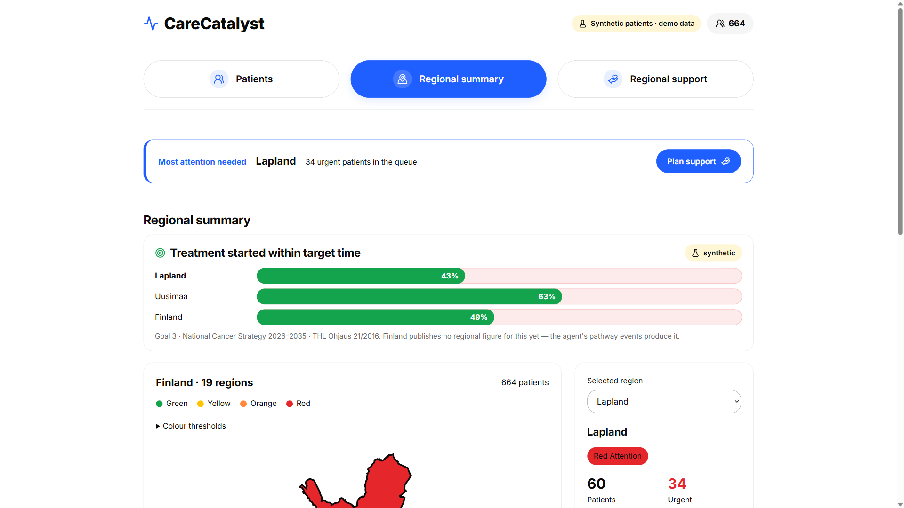
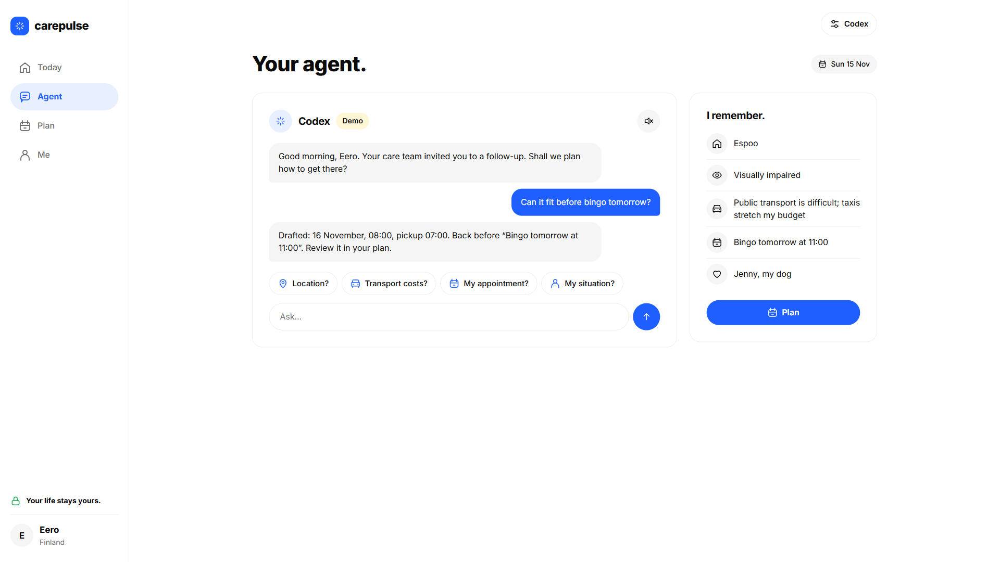

# CareCatalyst

**Closing gaps. Connecting care.**
Junction 2026 · AstraZeneca challenge *Equal Care Across Finland*

| ▶ Live demo | |
|---|---|
| **A · For counties (today)** | **[handan-majied1--carecatalyst-demo-web.modal.run](https://handan-majied1--carecatalyst-demo-web.modal.run)** |
| **B · For you (tomorrow)** | **[handan-majied1--carepulse-vision-web.modal.run](https://handan-majied1--carepulse-vision-web.modal.run)** |
| 🎬 Video | `[VIDEO LINK]` |

Both open in a private window without a login. All patients and regional values in the demos are synthetic.

<p>
  
  
</p>

## In 30 seconds

| | |
|---|---|
| 🔴 **Problem** | Finland knows *why* people drop out of cancer care (distance, fear, cost) and *how many* drop out. It doesn't know *who*. A cancelled scan or a no-show goes unnoticed, so nobody reaches out. |
| 🔵 **Solution (A, today)** | Counties dock an agent onto their existing systems (Apotti, Maisa). When a pathway stalls (not booked, cancelled, no-show), the agent calls, asks why and fixes it: a Kela taxi, a new slot, care at home. Only the anonymised *why* leaves, per step and region. |
| 🟢 **Goal 3 indicator** | **Patients start treatment within target times** (National Cancer Strategy 2026–2035, THL Ohjaus 21/2016). Finland publishes no regional figure for it yet. The agent's pathway events produce it. The demo shows it per region with synthetic values. |
| 🟡 **Vision (B, tomorrow)** | Everyone has a personal agent that knows their daily life. It talks agent to agent with the county and Kela, so no one has to explain their life again. |

## Data

**All patients and all regional values in the demos are synthetic.** Only the region boundaries (Statistics Finland, CC BY 4.0) and the cited key figures (strategy, Cancer Registry, Kela, studies) are public, each with a source. No real patient data is in any repo.

| Source | Used for | Licence |
|---|---|---|
| Finnish Cancer Registry (Syöpärekisteri), Syöpä 2024 and screening report 2024 | Incidence, screening gaps, stage recording | Public statistics, cited |
| THL: Ohjaus 21/2016, Sotkanet | Goal 3 indicator definition (no regional values used) | CC BY 4.0 |
| Kela open data 2025 | Travel reimbursements (€364M), Kela taxi | CC BY 4.0 |
| Statistics Finland | Region boundaries (demo map), causes of death | CC BY 4.0 |
| STM: National Cancer Strategy 2026–2035 and implementation roadmap | Goals and indicators ([PDFs](data/sources)) | Public document |
| Pirha 2025, Percac-Lima et al. 2015 (US RCT), Kim et al. 2018 | 4 % no-shows (Pirkanmaa 2025), −42 % no-shows (US RCT, human navigator), navigator cost | Published reports and papers, cited |

Full list: [docs/sources.md](docs/sources.md). Figures and limits: [data/README.md](data/README.md) and [docs/business-case.md](docs/business-case.md).

**Limits:** The agent never diagnoses. It asks why and books help. No automated decisions (GDPR Art. 22). The call effect comes from US navigator RCTs, and the HUS pilot would be the first Finnish test.

## Repository

| Folder | What's inside |
|---|---|
| [`concepts/today`](concepts/today) | **A**: county app (Vite + TypeScript), submodule [CareCatalyzer](https://github.com/HandanMajied2024/CareCatalyzer) |
| [`concepts/vision`](concepts/vision) | **B**: CarePulse personal agent (React + Vite), submodule [mobile_app](https://github.com/youcefjerbi/mobile_app) |
| [`docs/`](docs) | Concept, architecture, business case, challenge fit, sources |
| [`data/`](data) | Data map and source PDFs |
| [`presentation/`](presentation) | Screenshots and assets |
| [`video/`](video) | Video sources |

```bash
git clone --recurse-submodules https://github.com/HandanMajied2024/CareCatalyst.git
cd CareCatalyst/concepts/vision && npm install && npm run dev   # B on http://127.0.0.1:4174
```

Team skills for Claude Code (design, deck, video, cut-outs) are in [.claude/skills/](.claude/skills/).

## Team

Youcef Jerbi (lead) · Handan Majied · Hazem Dhaouadi

## Licence

[MIT](LICENSE) © 2026 CareCatalyst
