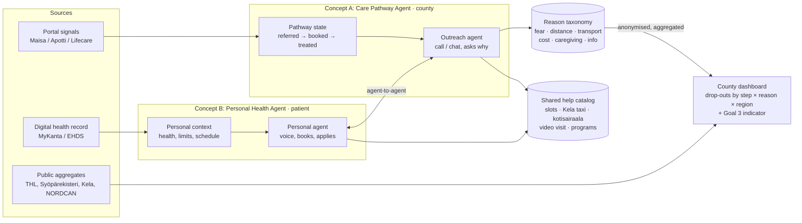

# Architecture: shared building blocks

Both concepts use the same core. A puts it on the institution's side, B on the patient's side.

## Shared pieces

| Block | Used by | Notes |
|---|---|---|
| Pathway state model | A, B | Steps: detection → referral → diagnosis → treatment start. Events: booked, cancelled, no-show, started |
| Reason taxonomy | A, B | Same categories so aggregates are comparable |
| Help catalog | A, B | Kela travel/taxi, kotisairaala, video visit, free slots, support programs, each with source |
| Dashboard | A | Drop-outs per step × reason × county, next to the Goal 3 indicator (definition from the national strategy; values in the demo are synthetic) |
| Agent-to-agent protocol | B ↔ A | Minimal: request slot, confirm transport, share consented facts only |

## Data boundaries

- Personal data stays with its owner (county for A, patient for B).
- Only anonymised aggregates leave (to dashboards, AZ).
- Hackathon demo: synthetic patients and synthetic regional values. Public are only the region boundaries (Statistics Finland, CC BY 4.0) and the cited key figures.
